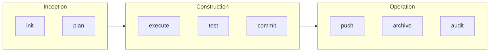

# AIDLC

AIDLC is a small development lifecycle for AI-assisted coding. You plan a change, do one piece at a time, test it, and keep a record in the repository.

The same plan works in Claude Code, Codex, Cursor, and VS Code. It does not call a paid model, and the chat plugins do not need Node.js or npm.

AIDLC is an independent project. It is not affiliated with AWS or AWS Labs.

## Install

**Claude Code.** In chat:

```text
/plugin marketplace add /absolute/path/to/AIDLC
/plugin install aidlc@aidlc
```

Then type `/aidlc:init-aidlc`.

**Codex.** Install the folder `plugins/aidlc`. Then use the `init-aidlc` skill.

**VS Code or Cursor.** Install the extension file:

```bash
code --install-extension extensions/vscode/aidlc-vscode-0.1.0.vsix
```

Open the Command Palette and run **AIDLC: Initialize Repository**.

## Three phases



`help-aidlc` is available in every phase.

### Inception

Agree what will change before editing application code.

| Command | What it does |
| --- | --- |
| `init-aidlc` | Detect the project and write instructions once |
| `plan-aidlc` | Write a plan and wait for approval |

### Construction

Build the approved change and keep the checks honest.

| Command | What it does |
| --- | --- |
| `execute-aidlc` | Do the next ready task |
| `test-aidlc` | Run the project's existing checks and record the result |
| `commit-aidlc` | Commit the planned files, and leave secrets and unrelated edits out |

### Operation

Ship the change and keep a short record.

| Command | What it does |
| --- | --- |
| `push-aidlc` | Push a short-lived branch and open a pull request |
| `archive-aidlc` | Move the plan to `.github/aidlc/archive` |
| `audit-aidlc` | Write a short summary to `CHANGELOG.md` |

In Claude Code the names are prefixed, for example `/aidlc:plan-aidlc`.

## Example

Inception

1. `/aidlc:init-aidlc`
2. `/aidlc:plan-aidlc` and describe the change
3. Approve the plan

Construction

4. `/aidlc:execute-aidlc`
5. `/aidlc:test-aidlc`
6. `/aidlc:commit-aidlc`

Operation

7. `/aidlc:push-aidlc`
8. `/aidlc:archive-aidlc`
9. `/aidlc:audit-aidlc`

Plans live in `.aidlc/plans/*.json`. That JSON file is the record. A checked box in Markdown does not mean the task is done.

## Safety

- Do not start a large change without an approved plan.
- Do not stage secrets or someone else's uncommitted files.
- Do not force-push, skip Git hooks, or merge a pull request automatically.
- A failed test stays failed until it really passes.

## Build from source

Building the toolkit itself needs Node.js 22 and npm. Using the installed plugin or VSIX does not.

```bash
npm install
npm test
npm run build
```

## License

MIT. See [LICENSE](LICENSE).
